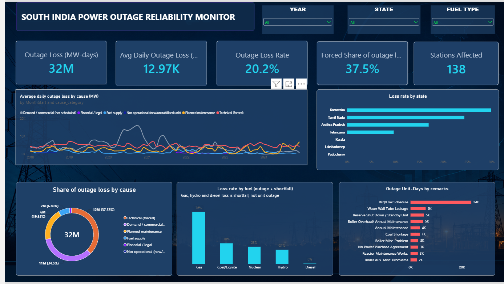
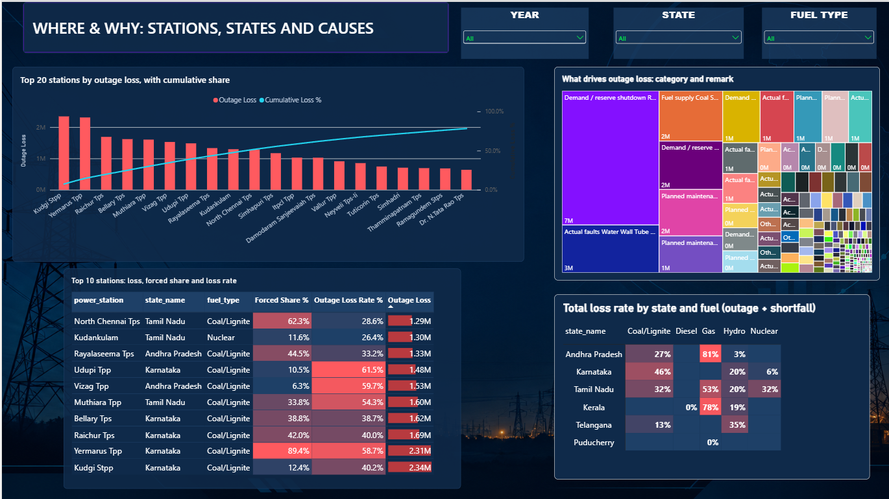
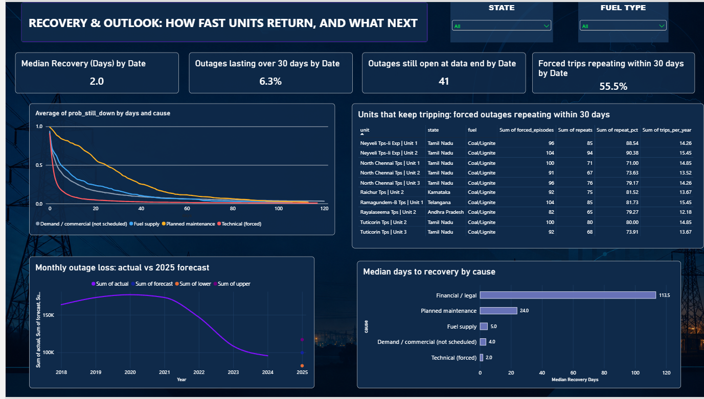

# South India Power Outage Reliability Analysis (2018 – Dec 2024)

**Business question:** *Where is power-plant capacity being lost in southern India, why, how long does it take to come back, and where should reliability effort go first?*

I cleaned 4.27 million daily plant-unit records down to 580,825 southern-region records, separated real breakdowns from demand-driven shutdowns, measured outage durations and repeat failures, and built a three-page Power BI report plus a SQL version of the analysis.

**Tools:** Python (pandas, matplotlib, seaborn), SQL (SQLite), Power BI, Git/GitHub.

---

## Dashboard

**1. Overview: how much is lost, and from what**


**2. Where and why: stations, states and causes**


**3. Recovery and outlook: how fast units return, and what next**


The file is `powerbi/south_outage_dashboard.pbix`. Open it in Power BI Desktop and point the data source at `data/processed/cleaned_south_outage_powerbi.csv.gz` and the CSVs in `reports/tables/`.

---

## Key findings

*Outage loss* excludes demand/schedule shortfalls (e.g. "Rsd/Low Schedule"), which are reported separately. Definitions are in [`docs/methodology.md`](docs/methodology.md).

| # | Finding | Evidence |
|---|---|---|
| 1 | Average daily outage loss **peaked in 2020 and has fallen about 54% since** | 19,185 MW/day in 2020 → 8,795 MW/day in 2024 |
| 2 | Only **about 38% of outage loss is equipment failure**; another 34% is commercial (reserve shutdown / low schedule) | Forced 37.5%, commercial 34.5%, planned 19.5%, fuel supply 6.9% |
| 3 | **Loss is concentrated in a few stations** | 10 of 47 stations account for 52% of outage loss, 21 stations for 80% |
| 4 | **Tamil Nadu has the most outage loss (36%)**, but **Karnataka loses the largest share of its capacity (29.9%)** | Share vs loss rate by state |
| 5 | **Coal/lignite carries 94% of outage loss.** Gas, hydro and diesel show no recorded outages; their loss is all shortfall | Fuel split, outage vs shortfall |
| 6 | **A few long outages dominate.** The median outage lasts 2 days, but outages over 30 days are 6% of episodes and **64% of lost MW-days** | Episode table |
| 7 | **Forced trips repeat.** 56% of forced outages start within 30 days of the same unit's previous outage ending; the worst units repeat about 9 times in 10 | Repeat-failure analysis |
| 8 | **Recovery time depends on cause**: forced median 2 days, planned maintenance about 24 days, financial/legal about 114 days (only 4 episodes) | Kaplan–Meier curves, medians |
| 9 | **Seasonality is commercial, not technical.** Forced loss is almost flat across months (about 4,300–5,200 MW/day), while commercial loss swings from about 2,300 to 6,000 | Monthly split by cause |

## What the data suggests

These are suggestions drawn from the patterns above, not proven causes.

1. **Start with the repeat offenders.** 61 of 151 units repeat at least half the time and account for 73% of all repeat trips. In 24% of repeat trips the remark is the same as the previous trip, which suggests the earlier fix did not hold. Units such as Neyveli TPS-II Expansion, North Chennai, Tuticorin and Raichur are the obvious places for a root-cause review.
2. **Escalate outages that pass the two-week mark.** Short outages are cheap in lost capacity; the ones that run past 30 days carry most of the loss. A review trigger at 7 to 14 days would target the cases that matter, and 41 outages were still open when the data ends.
3. **Rank reliability on forced loss, not total outage loss.** About a third of outage loss is a market decision. Karnataka, for example, loses more capacity to commercial shutdown (14.3% of capacity) than to forced outages (11.5%), so a total-loss ranking would misjudge plant condition.
4. **Plan and forecast on forced loss.** The 2025 forecast peaks in August (about 11,600 MW/day) largely because commercial shutdowns peak then. Forced loss barely moves with the season, so a forced-only forecast per state or station would be more useful operationally.

## Method in brief

1. **Clean** (notebook 01): keep the Southern region and 2018-01-01 to 2024-12-10, remove 377,003 duplicate unit-day records, standardise blanks, rename fields and add cause and status columns. Row counts reconcile exactly from raw to cleaned.
2. **Define** (notebook 02): split *outage loss* from *shortfall*, analyse per year using daily averages because years have unequal days of data, and rebuild outage start dates that are blank after mid-November 2024.
3. **Episodes** (notebook 02): convert daily rows into one row per unit outage to measure true duration, recovery and repeat trips.
4. **Reliability analysis** (notebook 02): station Pareto, repeat failures, Kaplan–Meier recovery curves (which handle outages still ongoing at the end of the data), and a monthly forecast chosen by backtest.
5. **SQL** (notebook 03 and `sql/queries.sql`): ten queries using window functions, CTEs and conditional aggregation. The repeat-failure query reproduces the Python result exactly (2,827 repeats across 5,090 forced episodes).

## Repository structure

```
.
├── README.md
├── requirements.txt
├── .gitignore
├── data/
│   ├── README.md                       # sources, dictionary, how to get the raw file
│   ├── raw/                            # (git-ignored) daily-power-outage.csv
│   ├── processed/
│   │   └── cleaned_south_outage_powerbi.csv.gz   # cleaned dataset (7 MB)
│   └── sample/cleaned_sample_5k.csv    # 5,000-row sample
├── notebooks/
│   ├── 01_before_after_cleaning.ipynb       # raw vs cleaned, first look
│   ├── 02_outage_analysis_extended.ipynb    # full analysis, episodes, reliability, forecast
│   └── 03_sql_analysis.ipynb                # the same questions in SQL
├── sql/
│   └── queries.sql                     # 10 reusable queries (SQLite)
├── reports/
│   ├── figures/                        # dashboard screenshots
│   └── tables/                         # episodes, repeat_units, km_curves, forecast
├── powerbi/
│   ├── south_outage_dashboard.pbix
│   └── assets/dashboard_background.png
└── docs/
    ├── methodology.md                  # metric definitions
    ├── cleaning_rules.md               # raw → cleaned, step by step
    └── Daily_Power_Outage_codebook.xlsx
```

## How to run

```bash
git clone https://github.com/ARZO0876543/south-india-power-outage-analysis.git
cd south-india-power-outage-analysis
python -m venv .venv && source .venv/bin/activate   # Windows: .venv\Scripts\activate
pip install -r requirements.txt
jupyter lab
```

- Notebooks 02 and 03 run as they are, because the cleaned data is in the repo.
- Notebook 01 also needs the raw file (about 480 MB). See [`data/README.md`](data/README.md) for where to put it.
- Every notebook is saved with its outputs, so you can read them on GitHub without running anything.

## Limitations

- `loss_mw` is a daily snapshot of capacity, so totals are **MW-days, not energy (MWh)**.
- 77 calendar days are missing from the source data; yearly comparisons use daily averages for that reason.
- `outage_date` is blank for most outage rows from mid-November 2024; it was rebuilt from each unit's earlier days.
- `expected_sync_date` appears to be updated once units return, so expected-vs-actual accuracy is a data check, not evidence that station estimates are reliable.
- The cause categories and some cleaning columns (`cause_category`, `in_service`) come from the supplied cleaned file; the exact rules behind them were not available to reproduce.
- The forecast is a simple model with a backtest error of about 18% and should be read as indicative.

## Data source

Daily Power Outage dataset (see [`docs/Daily_Power_Outage_codebook.xlsx`](docs/Daily_Power_Outage_codebook.xlsx)). Retrieved 2025-04-30; last updated by the source on 2025-04-22.
